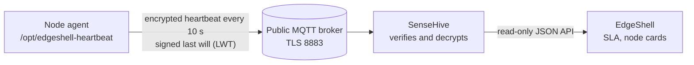

# MQTT Heartbeat Service

[](https://github.com/855princekumar/mqtt-heartbeat-service/actions/workflows/ci.yml)


A tiny agent that tells a receiver "this node is alive" every few seconds over
a **public MQTT broker**, independent of any VPN. It is the second, independent
health signal for [EdgeShell](https://github.com/855princekumar/edgeshell): when
the VPN glitches but the internet works, heartbeats keep arriving, so uptime
(SLA) is measured precisely instead of counting VPN outages as node downtime.
The receiver is [SenseHive](https://github.com/855princekumar/sense-hive).

## Contents

1. [How it works](#how-it-works)
2. [Security on a public broker](#security-on-a-public-broker)
3. [Install](#install)
4. [Configuration and hot reload](#configuration-and-hot-reload)
5. [Operate](#operate)
6. [Tests and CI](#tests-and-ci)

## How it works



| Message | When | Meaning |
|---|---|---|
| `birth` | the agent connects | the node is up |
| `hb` | every `interval` seconds (10) | the node is still up |
| `lwt` | the broker publishes it if the agent's connection drops | the node is gone |

No heartbeat for a while without a last will means the path is broken (broker
or internet), shown as **silent**, not as offline.

## Security on a public broker

Anyone can subscribe to everything on a public broker, so the protocol assumes
every message is visible to strangers and that strangers will try to inject.

| Threat | Protection |
|---|---|
| Reading what nodes say | Every message is **AES-256-GCM encrypted**. The plaintext is only the node name, a time, a counter, the kind and the agent version: no addresses, no credentials, no metrics, ever |
| Finding the fleet | Topics are **random-looking and change every 10 minutes** (derived from a key, like a 2FA code); the MQTT client id is random; nothing names EdgeShell or the node |
| Injecting or faking a heartbeat | Messages are **authenticated**. Each node has **its own key**; a node, or anyone who stole one node's key, cannot speak for another node |
| Replaying old messages | Times must be within 2 minutes and strictly increasing per node; a recorded message is rejected |
| A fake or old "offline" | The last will carries the **session** (connect time); an old will can never take a live node offline |
| A message moved to another topic | The topic is part of the authenticated data |
| The broker itself | TLS with certificate verification; the broker sees only opaque bytes |
| The node | Runs as an unprivileged system user with systemd hardening (read-only system, no new privileges, no capabilities, memory and CPU caps) |

Keys: one 32-byte **master key** lives only with the receiver (SenseHive) and
the provisioner (EdgeShell). A node gets only what it needs (its node key, its
key id and the topic key), never the master key. Details:
[`heartbeat_protocol.py`](heartbeat_protocol.py) (the same file is used by the
agent, SenseHive and EdgeShell, pinned by test vectors).

## Install

EdgeShell installs it from **Node Fleet, Fleet Setup, Heartbeat agent** (one
node or the whole fleet). By hand, on a node, with the two files and an
`agent.env` written for that node:

```bash
sudo bash install.sh agent.env      # install or update
sudo bash install.sh --uninstall    # remove everything
```

Requirements: Python 3.7+, and the OS packages `python3-paho-mqtt`,
`python3-yaml`, `python3-cryptography` (installed automatically with apt; no
pip, nothing downloaded at run time).

| Path | Owner, mode | Content |
|---|---|---|
| `/opt/edgeshell-heartbeat/heartbeat_agent.py`, `heartbeat_protocol.py` | root, 0644 | the agent |
| `/opt/edgeshell-heartbeat/agent.env` | root:hbagent, 0640 | this node's name and keys (never bulk-pushed) |
| `/opt/edgeshell-heartbeat/config.yaml` | root, 0644 | fleet settings, hot reloaded (no secrets) |
| `/etc/systemd/system/edgeshell-heartbeat.service` | root | the service |

## Configuration and hot reload

`config.yaml` holds the fleet-wide settings and **no secrets**, so the same file
can be pushed to every node:

```yaml
broker: broker.hivemq.com   # MQTT broker host
port: 8883                  # 8883 = MQTT over TLS
tls: true                   # verify the broker certificate (keep true on public brokers)
interval: 10                # seconds between heartbeats (5 to 3600)
```

The agent checks the file on every beat and applies a change **without a
restart**:

- a new `interval` applies at once;
- a new `broker`, `port` or `tls` makes a clean switch (disconnect, connect to
  the new broker, new last will), so no false "offline" is sent;
- a broken, half-written or invalid file is **ignored** with a log line, and the
  agent keeps beating with its last good settings;
- a missing file means the safe defaults above;
- updating the agent never overwrites a pushed `config.yaml`.

Write it atomically when you can (write `config.yaml.new`, then `mv` it over).

## Operate

```bash
systemctl status edgeshell-heartbeat
journalctl -u edgeshell-heartbeat -f      # connects, reloads, retries
```

The agent reconnects by itself with backoff (2 s up to 60 s) when the broker
or the internet is away.

## Tests and CI

| Check | What it proves |
|---|---|
| Unit tests on Python 3.9, 3.11, 3.12, 3.13 with paho-mqtt 1.6 and 2.1 | protocol vectors, tampering, forgery, replay, impersonation between nodes, stale last wills, hot reload (valid, invalid, missing file) |
| Real broker (Mosquitto) | birth and heartbeats arrive and verify, forged messages are rejected, the signed last will arrives after a connection is cut |
| systemd install (Debian 12) | runs as `hbagent` with hardening, file modes, hot reload with no restart, an update keeps a pushed config, uninstall removes everything |
| Bandit, gitleaks, lint | no risky code, no secrets in history |

Against the real public broker (optional, outside CI):

```bash
python tests/live_check.py --broker broker.hivemq.com
```

## License

MIT
