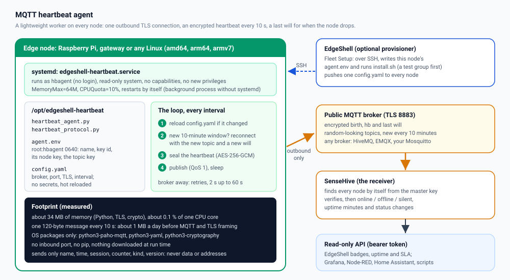
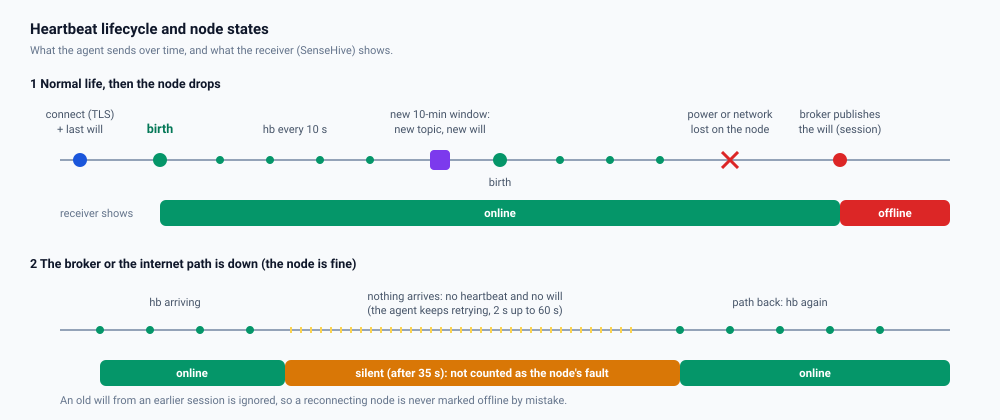

<p align="center">
  
</p>

# MQTT Heartbeat Service

[](https://github.com/855princekumar/mqtt-heartbeat-service/actions/workflows/ci.yml)
[](https://github.com/855princekumar/mqtt-heartbeat-service/actions/workflows/codeql.yml)


-orange)
[](https://github.com/855princekumar/sense-hive)
[](https://github.com/855princekumar/edgeshell)

A tiny worker for every edge node. It tells a receiver **"this node is alive"**
every 10 seconds over a **public MQTT broker**, encrypted and authenticated, and
leaves an MQTT **last will** so the receiver also learns when the node drops.
It needs no VPN, no inbound port and no per-node setup on the receiver.

**A SenseHive extension, and an independent project.** The agent runs on the
nodes; [SenseHive](https://github.com/855princekumar/sense-hive) is its
receiver and dashboard. Each repository has its own releases, tests and
security policy, and you can run the agent with SenseHive alone, without
EdgeShell.

In an [EdgeShell](https://github.com/855princekumar/edgeshell) fleet it is the
second, independent health signal: when the VPN glitches
but the internet works, heartbeats keep arriving, so uptime (SLA) is measured
precisely instead of counting VPN outages as node downtime. The receiver is
[SenseHive](https://github.com/855princekumar/sense-hive), which finds the
nodes by itself and serves their state through a read-only API.



## Contents

1. [Why a lightweight heartbeat worker](#why-a-lightweight-heartbeat-worker)
2. [How it works](#how-it-works)
3. [Works with SenseHive, EdgeShell and MQTT last wills](#works-with-sensehive-edgeshell-and-mqtt-last-wills)
4. [Security on a public broker](#security-on-a-public-broker)
5. [Install](#install) (full guide: [docs/SETUP.md](docs/SETUP.md))
6. [Configuration and hot reload](#configuration-and-hot-reload)
7. [Operate](#operate)
8. [Tests and CI](#tests-and-ci)
9. [Related projects](#related-projects)

## Why a lightweight heartbeat worker

| Need | How the agent meets it |
|---|---|
| Know a node is up when the VPN or SSH path is down | It uses a different path: one outbound TLS connection to a public MQTT broker |
| Tell "node down" from "network path down" | The broker publishes the node's **last will** when its connection drops (`offline`); if nothing arrives at all, the receiver shows `silent` instead |
| Run on small devices for years | About **34 MB** of memory and **0.1 %** of one CPU core (measured), capped by systemd at 64 MB and 10 % |
| Little bandwidth, also on mobile links | One **120-byte** message every 10 s: about 1 MB a day before MQTT and TLS framing |
| Nothing to maintain per node | Settings in one `config.yaml` for the whole fleet, **hot reloaded**; the receiver needs no list of nodes |
| No new attack surface on the node | No listening port; runs as an unprivileged user in a systemd sandbox; holds only its own key |
| Easy to install anywhere | Three files and `install.sh`; OS packages only (no pip, nothing downloaded at run time); systemd or a plain background process |

### Resource usage (measured)

On the node, one agent:

| | Measured |
|---|---|
| Memory | **34 MB** resident (Python, TLS and crypto libraries); systemd caps it at 64 MB |
| CPU | **0.08 s per minute**: about **0.1 %** of one core, including start-up |
| Network | one **120-byte** message (plus a 31-byte topic) every 10 s: about **1 MB a day** of payload before MQTT and TLS framing |
| Disk | four small files in /opt/edgeshell-heartbeat, about 16 KB; nothing written at run time (logs go to the journal) |
| Ports | none listening; one outbound connection |

On the receiver ([SenseHive](https://github.com/855princekumar/sense-hive/blob/main/docs/PERFORMANCE.md)),
**500 agents** at the default interval (50 messages/s to decrypt and verify):

| | Measured |
|---|---|
| CPU | **8.7 %** of one core (0.04 % idle) |
| Memory | **34 MB** (28 MB idle) |
| Heartbeats refused | 0; all 500 nodes online |
| `GET /api/heartbeat/nodes` with 500 nodes | 4.7 ms p50, 5.2 ms p95 |

Agent: amd64, Python 3.11, paho-mqtt 2.1, one minute against a local Mosquitto
broker. Receiver: SenseHive 1.4.2 in Docker, 500 simulated agents, two minutes.
Both on an Intel Core i7-1185G7 laptop; ARM boards use the same memory and a
few times the CPU share, still a fraction of one percent for the agent.

## How it works


1. **Identity.** Each node has an `agent.env` with its name, a key id, **its
   own node key** and the fleet's topic key, all derived from a fleet master
   key that the node never sees (`heartbeat_protocol.provision`).
2. **Connect.** The agent opens one TLS connection (certificate verified) with
   a random client id and registers a **last will**: an encrypted `lwt`
   message for this session that the broker publishes if the connection drops.
3. **Birth.** It sends `birth` as soon as it is connected.
4. **Beat.** Every `interval` seconds (10) it sends an encrypted `hb` with the
   time and a counter.
5. **Rotate.** Topics are derived from the topic key and change every 10
   minutes. At each new window the agent reconnects on the new topic with a
   new will.
6. **Reload.** On every beat it checks `config.yaml` and applies changes at
   once (interval, broker, port, TLS) without a restart.

| Message | When | Receiver shows |
|---|---|---|
| `birth` | the agent connects | `online` |
| `hb` | every `interval` seconds (10) | `online` |
| `lwt` | the broker publishes it if the agent's connection drops | `offline` |
| (nothing) | broker or internet path down | `silent` after 35 s, not the node's fault |



Every message is `version | key id | nonce | AES-256-GCM ciphertext`. The
ciphertext holds only `{name, kind, time, session, counter, agent version}`.

## Works with SenseHive, EdgeShell and MQTT last wills

- **SenseHive** ([repository](https://github.com/855princekumar/sense-hive),
  [heartbeat guide](https://github.com/855princekumar/sense-hive/blob/main/docs/HEARTBEAT.md))
  is the receiver. Give it the fleet master key (`HEARTBEAT_MASTER_KEY`) and it
  computes the topics, derives each sender's key from the key id in the
  message, verifies it, and shows a node on its **first heartbeat**: there is
  nothing to add per node. Its `/heartbeats` page and read-only API
  (`/api/heartbeat/status`, `nodes`, `minutes`, `events`) serve the state to
  EdgeShell, Grafana, Node-RED, Home Assistant or scripts. SenseHive's normal
  MQTT logging (topics you add) keeps working next to it.
- **EdgeShell** ([repository](https://github.com/855princekumar/edgeshell))
  installs and updates the agent from **Fleet Setup** over SSH, writes each
  node's `agent.env`, pushes `config.yaml` to the whole fleet, and shows
  heartbeat badges, uptime and SLA on its node cards.
- **MQTT last will (LWT):** standard MQTT 3.1.1, so any broker works (HiveMQ,
  EMQX, Mosquitto, your own). The will is encrypted and carries the session
  (the connect time), so an old will can never mark a live, reconnected node
  offline.
- **The protocol** is one file, [`heartbeat_protocol.py`](heartbeat_protocol.py),
  identical in the agent, SenseHive and EdgeShell and pinned by shared test
  vectors. Any receiver that implements it can read the fleet.

## Security on a public broker

Anyone can subscribe to everything on a public broker, so the protocol assumes
every message is visible to strangers and that strangers will try to inject.

| Threat | Protection |
|---|---|
| Reading what nodes say | Every message is **AES-256-GCM encrypted**. The plaintext is only the node name, a time, a counter, the kind and the agent version: no addresses, no credentials, no metrics, ever |
| Finding the fleet | Topics are **random-looking and change every 10 minutes** (derived from a key, like a 2FA code); the MQTT client id is random; nothing names EdgeShell or the node |
| Injecting or faking a heartbeat | Messages are **authenticated**. Each node has **its own key**; a node, or anyone who stole one node's key, cannot speak for another node |
| Replaying old messages | Times must be within 2 minutes and strictly increasing per node; a recorded message is rejected |
| A fake or old "offline" | The last will carries the **session** (connect time); an old will can never take a live node offline |
| A message moved to another topic | The topic is part of the authenticated data |
| The broker itself | TLS with certificate verification; the broker sees only opaque bytes |
| The node | Runs as an unprivileged system user with systemd hardening (read-only system, no new privileges, no capabilities, memory and CPU caps) |

Keys: one 32-byte **master key** lives only with the receiver (SenseHive) and
the provisioner (EdgeShell). A node gets only what it needs (its node key, its
key id and the topic key), never the master key. See also
[SECURITY.md](SECURITY.md).

## Install

**On the node, with a join token from SenseHive** (no EdgeShell needed):

1. In SenseHive (1.8+): **Heartbeats, Add node**, a name for this node, **Create token**.
2. On the node, over SSH or at its own screen:

   ```bash
   git clone https://github.com/855princekumar/mqtt-heartbeat-service
   cd mqtt-heartbeat-service
   sudo python3 setup.py           # paste the join token when asked (it is not shown)
   ```

3. The node appears on SenseHive's Heartbeats page within seconds, by itself.

`setup.py` checks the token (a cut or changed paste is refused), writes this
node's `agent.env` and `config.yaml` (the broker SenseHive listens on), and runs
`install.sh`: the hardened systemd service below, started now and at boot.

```bash
sudo python3 setup.py --status      # running? which node, which fleet
sudo python3 setup.py --uninstall   # remove everything
git pull && sudo python3 setup.py   # update (paste the token again)
```

The token holds this node's name and keys and the broker, **never the fleet
master key**. Every SenseHive has its own fleet: nodes set up from one
SenseHive's tokens never appear in another's, even on the same public broker
(`setup.py --status` and SenseHive's **Add node** show the same fleet id).

**With EdgeShell:** **Node Fleet, Fleet Setup, Heartbeat agent**; tick a test
group first, then the fleet. EdgeShell does the same over SSH for many nodes.

**By hand, step by step** (making `agent.env` yourself from the master key):
[docs/SETUP.md](docs/SETUP.md#c-by-hand-with-the-master-key).

Requirements: Python 3.7+, and the OS packages `python3-paho-mqtt`,
`python3-yaml`, `python3-cryptography` (installed automatically with apt; no
pip, nothing downloaded at run time).

| Path | Owner, mode | Content |
|---|---|---|
| `/opt/edgeshell-heartbeat/heartbeat_agent.py`, `heartbeat_protocol.py` | root, 0644 | the agent |
| `/opt/edgeshell-heartbeat/agent.env` | root:hbagent, 0640 | this node's name and keys (never bulk-pushed) |
| `/opt/edgeshell-heartbeat/config.yaml` | root, 0644 | fleet settings, hot reloaded (no secrets) |
| `/etc/systemd/system/edgeshell-heartbeat.service` | root | the service |

## Configuration and hot reload

`config.yaml` holds the fleet-wide settings and **no secrets**, so the same file
can be pushed to every node:

```yaml
broker: broker.hivemq.com   # MQTT broker host
port: 8883                  # 8883 = MQTT over TLS
tls: true                   # verify the broker certificate (keep true on public brokers)
interval: 10                # seconds between heartbeats (5 to 3600)
```

The agent checks the file on every beat and applies a change **without a
restart**:

- a new `interval` applies at once;
- a new `broker`, `port` or `tls` makes a clean switch (disconnect, connect to
  the new broker, new last will), so no false "offline" is sent;
- a broken, half-written or invalid file is **ignored** with a log line, and the
  agent keeps beating with its last good settings;
- a missing file means the safe defaults above;
- updating the agent never overwrites a pushed `config.yaml`.

Write it atomically when you can (write `config.yaml.new`, then `mv` it over).

## Operate

```bash
systemctl status edgeshell-heartbeat
journalctl -u edgeshell-heartbeat -f      # connects, reloads, retries
```

The agent reconnects by itself with backoff (2 s up to 60 s) when the broker
or the internet is away. Troubleshooting: [docs/SETUP.md](docs/SETUP.md#troubleshooting).

## Tests and CI

| Check | What it proves |
|---|---|
| Unit tests on Python 3.9, 3.11, 3.12, 3.13 with paho-mqtt 1.6 and 2.1 | protocol vectors, tampering, forgery, replay, impersonation between nodes, stale last wills, hot reload (valid, invalid, missing file) |
| Real broker (Mosquitto) | birth and heartbeats arrive and verify, forged messages are rejected, the signed last will arrives after a connection is cut |
| systemd install (Debian 12) | runs as `hbagent` with hardening, file modes, hot reload with no restart, an update keeps a pushed config, uninstall removes everything |
| Install without systemd (Ubuntu 22.04 container) | the background-process mode installs, beats and uninstalls |
| Join token end to end (with SenseHive) | SenseHive issues a token, `setup.py` installs a real systemd service on Debian 12, the node appears online by itself, a second SenseHive on the same broker never sees it, a cut token installs nothing, uninstall removes everything |
| `setup.py` unit tests | tokens read exactly as SenseHive makes them, never the master key, cut, edited and hostile tokens refused with a plain reason |
| Bandit, gitleaks, CodeQL, lint | no risky code, no secrets in history |

Against the real public broker (optional, outside CI):

```bash
python tests/live_check.py --broker broker.hivemq.com
```

## Related projects

| Project | Role |
|---|---|
| [EdgeShell](https://github.com/855princekumar/edgeshell) | Fleet control plane: installs this agent, shows heartbeat status, uptime and SLA |
| [SenseHive](https://github.com/855princekumar/sense-hive) | The receiver: verifies heartbeats, finds nodes by itself, read-only API; also logs MQTT topics on a dashboard |
| [OpenRemoteGUI](https://github.com/855princekumar/OpenRemoteGUI) | Browser remote desktop on nodes |
| [Pi Fleet Emulator](https://github.com/855princekumar/pi-fleet-emulator) | Emulated Raspberry Pi fleet for testing |

## License

MIT
